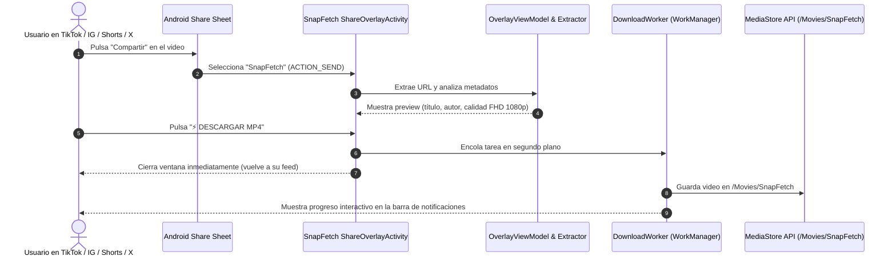

# SnapFetch ⚡
### Native Android Social Media Video Downloader (Kotlin + Jetpack Compose)
*Descargador de videos de redes sociales nativo para Android sin salir de tu feed de navegación.*

---

## 🇪🇸 Descripción en Español

**SnapFetch** es una aplicación nativa para Android de alto rendimiento construida con **Kotlin 1.9+** y **Jetpack Compose (Material 3)**. Está diseñada con una filosofía clave: **permitir descargar videos de redes sociales (TikTok, Instagram Reels, YouTube Shorts y X/Twitter) de forma instantánea sin obligar al usuario a salir de la aplicación donde está navegando**.

### 🌟 Características Principales
1. **Flujo Cero Interrupciones (Android Share Target):** Al pulsar "Compartir" en TikTok/Instagram/Shorts/X y seleccionar SnapFetch, se abre una `Activity` translúcida con fondo semitransparente (`dimmed backdrop`), mostrando un BottomSheet flotante superpuesto directamente sobre el video que estás viendo.
2. **Extracción Inteligente de Enlaces:** Intercepta `ACTION_SEND` (`text/plain`), limpiando etiquetas de seguimiento (`utm`, `igsh`, `si`) y detectando la plataforma automáticamente.
3. **Modo Rápido 1-Clic (`⚡ DESCARGAR MP4`):** Un botón prominente que cierra el diálogo inmediatamente y lanza la descarga en segundo plano vía `WorkManager`. El usuario continúa navegando sin esperas.
4. **Diseño Sahara (Warm Minimalism):** Paleta cuidada con tonos tierra cálidos (`#c2652a`), lino cálido (`#faf5ee`), tipografía editorial serif para titulares y sans-serif para controles. **Soporte completo para Modo Claro y Modo Oscuro** adaptado al sistema del teléfono.
5. **Memoria de Preferencias (Jetpack DataStore):** Guarda el modo de descarga predeterminado (Rápido 1-Clic vs Avanzado con selección de 4K, 1080p, 720p o MP3) y recuerda las opciones del usuario.
6. **Notificación Interactiva en la Barra de Estado:** Barra de progreso en tiempo real (0% - 100%), botón de cancelar y notificación de video listo para reproducir.
7. **Almacenamiento Scoped Storage (Android 10+):** Utiliza la `MediaStore API` guardando directamente en `/Movies/SnapFetch` y `/Music/SnapFetch` sin solicitar permisos legacy invasivos.

---

## 🇺🇸 Description in English

**SnapFetch** is a high-performance native Android application built with **Kotlin 1.9+** and **Jetpack Compose (Material 3)**. Its core design philosophy: **download videos from social platforms (TikTok, Instagram Reels, YouTube Shorts, and X/Twitter) instantly without ever leaving your active social feed**.

### 🌟 Key Features
1. **Zero-Interruption Flow (Android Share Target):** Tap "Share" inside TikTok, Instagram, Shorts, or X, pick SnapFetch, and a translucent floating BottomSheet appears directly on top of your current screen with a dimmed background.
2. **Smart URL Parsing:** Intercepts `ACTION_SEND` (`text/plain`), strips tracking parameters (`utm`, `igsh`, `si`), and detects the social network platform automatically.
3. **1-Click Fast Download (`⚡ DESCARGAR MP4`):** Large CTA button that immediately dismisses the overlay and offloads the download to `WorkManager` in the background. Return to scrolling instantly.
4. **Sahara Design System (Warm Minimalism):** Elegant warm terracotta (`#c2652a`), warm linen (`#faf5ee`), serif headlines, and clean modern body typography. **Full support for Dark Mode and Light Mode** according to system settings.
5. **User Preferences Memory (Jetpack DataStore):** Persists default download mode (1-Click Fast Mode vs Custom Mode with 4K, 1080p, 720p, or MP3 audio extraction) and remembers user choices.
6. **Interactive Status Bar Notification:** Real-time progress bar (0% - 100%), cancel action, and quick-tap completion notification to view downloaded videos.
7. **Scoped Storage (Android 10+):** MediaStore API integration saving media directly to public `/Movies/SnapFetch` and `/Music/SnapFetch` without requiring invasive legacy storage permissions.

---

## 📐 Architecture & Tech Stack

```
SnapFetch/
├── app/src/main/
│   ├── AndroidManifest.xml                  # ACTION_SEND intent filter + Translucent Theme
│   ├── java/com/snapfetch/app/
│   │   ├── SnapFetchApplication.kt          # Channel init & DI Singletons
│   │   ├── domain/
│   │   │   ├── model/                       # VideoMetadata, DownloadQuality, DownloadMode, SocialPlatform
│   │   │   └── repository/                  # VideoExtractorRepository, PreferencesRepository
│   │   ├── data/
│   │   │   ├── repository/                  # DataStore & VideoExtractor implementations
│   │   │   └── worker/                      # DownloadWorker (WorkManager) + Notifications
│   │   ├── ui/
│   │   │   ├── theme/                       # Sahara Warm Minimalism (Dark & Light)
│   │   │   ├── overlay/                     # ShareOverlayActivity, SnapFetchOverlaySheet, ViewModel
│   │   │   └── main/                        # MainActivity dashboard & manual link tester
│   │   └── utils/
│   │       ├── UrlExtractor.kt              # Regex parser for TikTok, IG, Shorts, X
│   │       └── StorageHelper.kt             # MediaStore API Scoped Storage
```

- **Architecture:** Clean Architecture + MVI/MVVM with reactive Kotlin Flows.
- **UI Framework:** Jetpack Compose (BOM 2024.02.02) + Material 3.
- **Asynchronous Tasks:** Coroutines + Flow + WorkManager `CoroutineWorker`.
- **Image Loading:** Coil Compose.
- **Storage:** Android Jetpack DataStore Preferences + MediaStore API.
- **Networking:** OkHttp 4.12.

---

## 🚀 How It Works (Step-by-Step Flow)



---

## 🛠️ Build & Installation

1. Open the project in **Android Studio Hedgehog / Iguana / Jellyfish** or later.
2. Ensure **JDK 17** is configured under *Project Structure -> SDK Location*.
3. Build and run on an Android device or emulator running **Android 8.0 (API 26) up to Android 14+ (API 34)**:
   ```bash
   ./gradlew assembleDebug
   ```
4. Test sharing any link from TikTok, Instagram, YouTube Shorts or X to **SnapFetch**!

---

## 📄 License
This project is open-source under the Apache 2.0 License.
